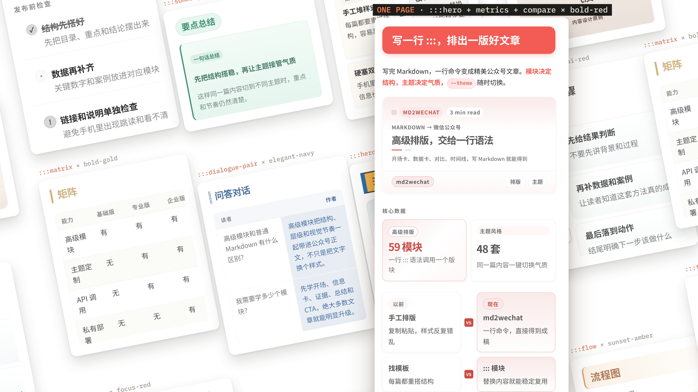
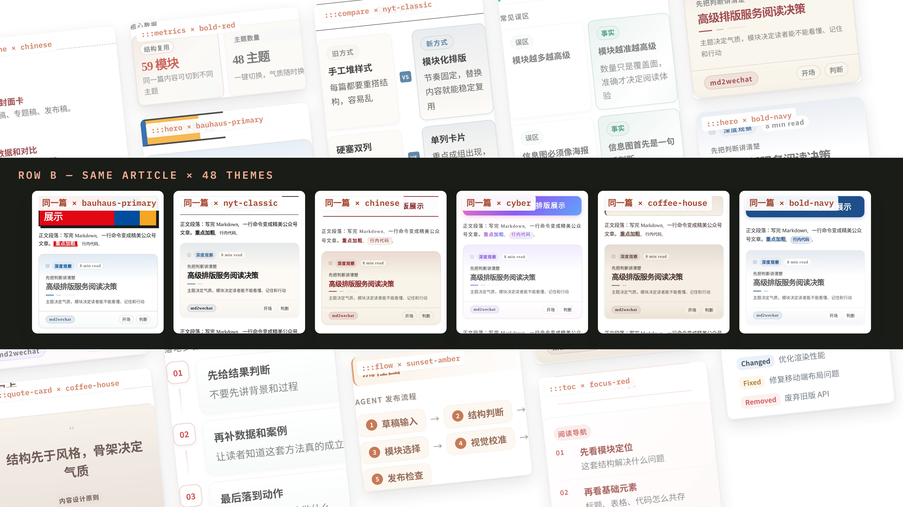
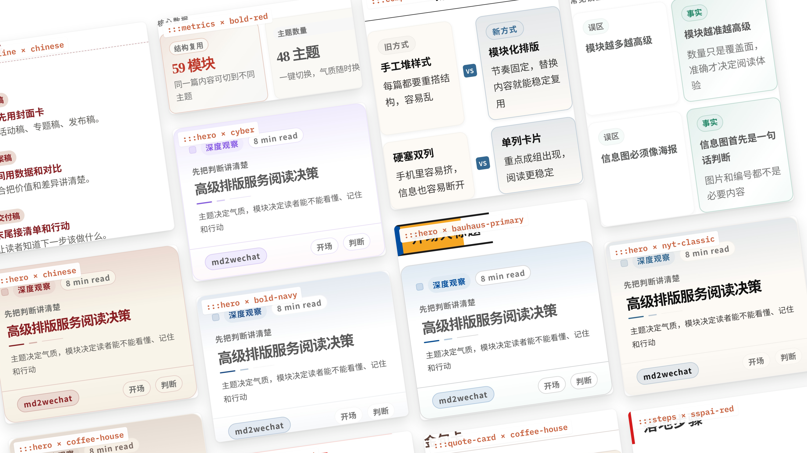

<div align="center">

<h1>
  
  md2wechat
</h1>

**面向 AI Agent 的微信公众号创作与发布 CLI**

写 Markdown，生成公众号排版，制作封面和文章配图，预览校验后推送草稿箱。



支持 Claude Code、Codex、WorkBuddy、Kimi Work、Hermes Agent、OpenClaw 等 Agent 通过 JSON discovery 稳定调用。

[](https://golang.org)
[](LICENSE)
[](https://www.npmjs.com/package/@qvqw2233/wechat-md)
[](#agent-工作流)

[排版效果](#排版效果) · [快速开始](#快速开始) · [转换模式](#转换模式) · [文档](#文档)

</div>

本仓库是 [geekjourneyx/md2wechat-skill](https://github.com/geekjourneyx/md2wechat-skill) 的社区版：默认在本机免费完成排版，不需要 API Key，只通过 npm 安装。与原作者无关联，问题请在 [Issues](https://github.com/LLP2333/md2wechat-skill/issues) 反馈。

> [!TIP]
> **v3.9.1 本地免费排版：默认 `--mode local` 在本机渲染 48 个主题和全部高级排版模块（83 个推荐场景、59 个推荐语法），不需要 API Key。** 通过 `npm install -g @qvqw2233/wechat-md` 安装，CLI 和两套 skill 都在 npm 包里；互动模块完整静态展示，微信内效果仍待验证。[布局指南](docs/LAYOUT.md) · [版本化安装](docs/INSTALL.md)

---

## 这个项目解决什么问题

md2wechat 把公众号发布流程拆成一组可验证的 CLI 命令：

| 场景 | md2wechat 提供 |
|---|---|
| Markdown 转微信 HTML | `convert`，支持预览、上传图片、创建草稿 |
| 发布前检查 | `inspect --json` 输出标题、摘要、图片、cover、draft readiness |
| 稳定排版 | 默认本地模式免费、离线返回最终 HTML，内置 48 个主题并渲染全部 `:::` 高级排版模块 |
| Agent 自动化 | `capabilities`、`doctor`、`themes`、`layout`、`providers` 等 discovery 命令 |
| 内容生产 | `write`、`humanize`、`title suggest`、`generate_cover`、`generate_infographic` |
| 定向产品写作（v3.7.0） | 组合目标搜索产品、文章平台、体裁与作者语气，也可准备分平台百科词条草稿；[使用说明](docs/WRITING.md) |
| 多平台草稿 | 本地准备正文，宿主复用已登录浏览器，按内置步骤写入知乎、CSDN、头条、腾讯云开发者社区草稿 |
| 多账号发布 | 命名公众号账号，本地只读发现，不输出 Secret |
| 微信白名单 | `wechat.proxy_url` 可让微信接口请求走你自己的固定出口代理 |

---

## 排版效果

先看文章排出来的样子，再选择使用方式。

<p align="center">

</p>

图中内容为排版示例，来自原项目；本地模式的配色和模块样式由本仓库实现，效果相近但不完全一致。

<details>
<summary>查看更多主题与模块样稿</summary>

<p align="center">

</p>

<p align="center">


</p>

</details>

[高级排版教程](docs/LAYOUT.md)

---

## 快速开始

```bash
npm install -g @qvqw2233/wechat-md@3.9.1
md2wechat version --json
md2wechat config init --json
md2wechat config validate --json
```

以下预览和转换命令默认使用**本地模式**（`--mode local`）：在本机渲染主题和高级排版模块，不需要 API Key，也不调用远程排版服务。先检查文章，再把 HTML 明确写入本地文件：

```bash
md2wechat inspect article.md --json
md2wechat preview article.md --output preview.html
md2wechat convert article.md --output article.html
```

以上命令不会上传图片或创建草稿。需要创建微信草稿时，先按同一目标检查，再显式执行副作用：

```bash
md2wechat inspect article.md --draft --cover cover.jpg --json
md2wechat convert article.md --draft --cover cover.jpg
```

如果使用可选的 `--wechat-account`，必须在 `inspect` 和 `convert` 两条命令中传入同一个账号名。

需要完全由大模型自定义风格时，可以用 `--mode ai`：它生成交给宿主 Agent / 外部 LLM 继续处理的 prompt，不会直接返回最终 HTML，见 [AI 模式使用步骤](docs/QUICKSTART.md#5-使用-ai-模式)。

v3.6.0 新增跨平台草稿流程：先准备正文，再由宿主 Agent 按内置步骤操作已登录的浏览器。已安装版本先用 `capabilities --json` 确认支持：

```bash
md2wechat sync prepare article.md --output ./article-prepared --json
md2wechat skills read md2wechat references/sync/workflow.md --json
```

准备结果是等待宿主执行，不代表草稿已创建。平台步骤、图片处理、头条标题限制和恢复方式见 [多平台草稿](docs/SYNC.md)。

安装、微信凭证和 IP 白名单配置见：

- [安装指南](docs/INSTALL.md)
- [微信凭证与 IP 白名单指南](docs/WECHAT-CREDENTIALS.md)
- [配置保姆级指南](docs/CONFIG-WALKTHROUGH.md)

---

## 转换模式

| 能力 | 本地模式（默认） | AI 模式 |
|---|---|---|
| 输出方式 | 本机直接生成微信 HTML | 生成 prompt，由外部 LLM 继续处理 |
| 凭证 | 不需要 | 不需要 |
| 主题 | 48 个主题 | 3 个基础 AI 主题 |
| 高级排版模块 | 渲染全部 `:::module`（交互模块输出为静态内容） | 不解析 |
| 网络 | 排版不联网 | 不联网 |

本地模式覆盖 83 个推荐场景条目、59 个推荐 `:::` 语法名、2 个兼容模块和 4 个基础增强能力，共 65 项渲染层语法能力。命名公众号账号和 `wechat.proxy_url` 都是本地配置，上传和建草稿不需要 API Key。

## Agent 工作流

md2wechat 给 Agent 提供可机读接口，减少猜测和误操作。

```bash
md2wechat capabilities --json
md2wechat doctor --json
md2wechat inspect article.md --json
md2wechat themes list --json
md2wechat layout list --json
md2wechat title suggest article.md --json
md2wechat title suggest article.md --json --hook-level 2
md2wechat skills list --json
md2wechat skills read md2wechat --json
```

按任务选择 discovery：用 `capabilities` 获取聚合路由事实，用资源的 `list` 做选择，用 `show` 查看单个资源的完整定义，仅在该资源支持时使用 `render`。JSON stdout 是单行紧凑对象并以换行结束；人类阅读时可在命令后加 `| jq`，不要要求 CLI 改成缩进输出。

文章命令边界固定为：`inspect` 返回结构化 metadata、checks、readiness targets 和 blockers；`preview` 只把成功的 converter 最终 HTML 原样写入文件；`convert` 执行转换，并且只在用户明确请求时执行 upload/draft 副作用。AI preview 返回 `PREVIEW_ACTION_REQUIRED` 且不创建输出文件，需要 readiness 时使用 `inspect --json`。

这些命令适合 Claude Code、Codex、WorkBuddy、Kimi Work、Hermes Agent、OpenClaw 以及其他能调用本地 CLI 的 Agent 使用。

Agent 可以据此判断：

- 当前 CLI 支持哪些命令
- 排版、草稿、上传是否具备执行条件
- 某篇文章能不能发草稿
- 当前主题和排版模块是否可用
- 标题建议是否应交给宿主 Agent / 外部模型完成
- 当前二进制内置的 Agent SOP 是什么

Brand Profile 支持把长期风格偏好写入 `~/.config/md2wechat/brand.md`，由 Agent 在写作和排版时读取。详见 [docs/BRAND-PROFILE.md](docs/BRAND-PROFILE.md)。

---

## 图片生成

md2wechat 支持两条图片路径。

先从当前二进制发现可用 preset，再调用图片 provider：

```bash
md2wechat prompts list --kind image --archetype cover --json
md2wechat prompts list --kind image --archetype infographic --json

md2wechat generate_cover --article article.md
md2wechat generate_cover --article article.md --preset cover-semantic-concept
md2wechat generate_infographic --article article.md --preset infographic-claude-warm
```

完整 preset 清单、用途和默认画幅以 `prompts list/show --json` 为准，文档只保留代表性示例。

支持 Volcengine、ModelScope、OpenRouter、OpenAI、Gemini、MiniMax、Atlas Cloud 等服务。配置见 [docs/IMAGE_PROVISIONERS.md](docs/IMAGE_PROVISIONERS.md)。

需要在生成结果中保持同一人物形象时，可以用 MiniMax 的主体参考（图生图）：

```bash
md2wechat generate_image "保持同一人物形象的秋日封面" \
  --subject-reference "https://cdn.example.com/portrait.png"
```

`--subject-reference` 只支持 `minimax` provider 的 `image-01` 模型，参考图必须是可公开访问的 `http(s)` 图片 URL。

使用宿主 Agent 的 Image Gen：

```bash
md2wechat generate_cover --article article.md --plan --json
md2wechat generate_infographic --article article.md --plan --json
```

计划模式返回 `IMAGE_PLAN_READY`，不请求图片 provider，不要求 `IMAGE_API_KEY`，也不会上传到微信。仅当当前宿主运行时实际暴露 Image Gen 工具时，Agent 才能继续执行图片生成。详见 [docs/AGENT_IMAGE_GEN.md](docs/AGENT_IMAGE_GEN.md)。

---

## 高级排版

默认的本地模式支持 `:::module` 语法，用 Markdown 写结构化公众号排版。

```markdown
:::hero
eyebrow: 深度观察
title: AI 时代的公众号写作
subtitle: 为什么读者愿意继续读下去
:::

:::callout
type: info
body: 高级排版模块在本地模式渲染，AI 模式不解析。
:::
```

查看和验证模块：

```bash
md2wechat layout list --json
md2wechat layout show hero --json
md2wechat layout validate --file article.md --json
```

`layout validate` 只验证语法；实际渲染效果用 `preview` 或 `convert` 查看。

完整教程见 [docs/LAYOUT.md](docs/LAYOUT.md)。

这里的计数不是同一维度：83 是上游使用场景条目，一个语法名可以覆盖多个结构变体；59 是 `layout list --json` 默认返回的推荐语法名。兼容模块默认不混入推荐列表。完整计数契约见 [docs/LAYOUT.md](docs/LAYOUT.md)。

---

## 常用命令

| 命令 | 用途 |
|---|---|
| `inspect` | 返回结构化 metadata、checks、readiness targets 和 blockers |
| `advise` | 为已有文章推荐可选的最小增强动作 |
| `preview` | 只写入成功转换的最终 HTML；失败或 AI handoff 不新建或覆盖 |
| `convert` | 转换 Markdown，并按显式请求执行 upload/draft 副作用 |
| `write` | 从想法生成文章 |
| `humanize` | 重写 AI 文章，支持 `authentic` 强度 |
| `title suggest` | 生成公众号标题建议的 AI 请求 |
| `generate_cover` | 生成封面图或图片计划 |
| `generate_infographic` | 生成信息图或图片计划 |
| `upload_image` | 上传图片到微信素材库 |
| `create_image_post` | 创建微信图片消息（小绿书/newspic） |
| `sync prepare` | 本地准备跨平台正文，等待宿主创建和核验草稿 |
| `config wechat-accounts` | 查看本地多公众号账号配置 |
| `doctor` | 本地配置体检 |

---

## 文档

| 文档 | 内容 |
|---|---|
| [QUICKSTART](docs/QUICKSTART.md) | 新手主路径 |
| [USAGE](docs/USAGE.md) | 命令完整说明 |
| [DISCOVERY](docs/DISCOVERY.md) | Agent discovery 契约 |
| [SYNC](docs/SYNC.md) | 知乎、CSDN、头条、腾讯云开发者社区草稿同步 |
| [WORKBUDDY](docs/WORKBUDDY.md) | WorkBuddy 安装、检查、预览与草稿确认流程 |
| [ADVISE](docs/ADVISE.md) | 已有文章的可选增强建议 |
| [LAYOUT](docs/LAYOUT.md) | 高级排版模块教程与 discovery 用法 |
| [HUMANIZE](docs/HUMANIZE.md) | AI 去痕与 authentic 写作 |
| [AGENT_IMAGE_GEN](docs/AGENT_IMAGE_GEN.md) | 宿主 Agent Image Gen 工作流 |
| [CONFIG](docs/CONFIG.md) | 配置字段和环境变量 |
| [FAQ](docs/FAQ.md) | 常见问题 |
| [TROUBLESHOOTING](docs/TROUBLESHOOTING.md) | 故障排查 |

---

## 许可与商业使用

本项目沿用原项目的 Source Available License（基于 BUSL-1.1），版权归原作者 geekjourneyx 所有。个人使用、学习、评估、非营利使用免费；商业使用、SaaS、客户交付、白标和训练数据用途需要原作者的商业授权，联系方式见 [LICENSE](LICENSE)。

---

<div align="center">

[文档](docs) · [Issues](https://github.com/LLP2333/md2wechat-skill/issues)

基于 [geekjourneyx/md2wechat-skill](https://github.com/geekjourneyx/md2wechat-skill) 的社区版

</div>

